<h1 align="center">claude-statusline</h1>

<p align="center">
  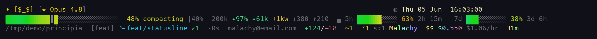
</p>

A little three-line status line for Claude Code. It shows your context, cost, git, and usage limits
at a glance — then lets you theme, animate, and fiddle with basically every pixel. Pure Node.js, no
dependencies beyond `node`, runs anywhere Claude Code does (Windows / macOS / Linux).

It started as "a nicer context bar" and got a bit out of hand: ~80 themes, a dozen bar styles, a pile
of animations, a mood pet that judges your spending, and a styling engine where **every element** can
pick its own colour, weight, capitalisation, font, and animation. All opt-in — the default is calm.

```
⚡ [★ Opus 4.8]                                              ☾ Tue 14 Nov  22:13
▌▌▌▌▌▌▌▌▌▌░░░░░░░░░░░░░░░░░░  42%  |40%   200k  ✦97%   5h ▌▌▌▌▌▌░░░░ 63%   7d ▌▌▌░░ 38%
~/code/principia   ⎇ feat/statusline  +124/-18  ~1            Malachy   $0.23   31m
```

- **Line 1** — model + tier, effort/thinking, fast & vim mode, moon phase, the clock.
- **Line 2** — the context bar (truecolor gradient, half-block sub-sampling), %, token breakdown, and your 5h / 7d usage gauges.
- **Line 3** — working dir, full git status, your account name, session cost & age.
- **Run bars** *(opt-in)* — a progress bar per long-running job (training runs, evals, pulls), with
  step/epoch, ETA and train/val/eval metrics, stacked above the three lines while anything is going.
  See [Run progress](#run-progress).

---

## Install

1. Drop `statusline.js` at `~/.claude/statusline.js` (grab it from this repo, or build it — see [Development](#development)).
2. Point Claude Code at it in `~/.claude/settings.json` (Windows: `%USERPROFILE%\.claude\settings.json`):

```json
{
  "statusLine": { "type": "command", "command": "node ~/.claude/statusline.js", "refreshInterval": 1 }
}
```

`refreshInterval` is in **seconds** (minimum `1`); the clock and animations update once per second.

> Claude Code cancels an in-flight status line run when the next refresh fires, so a render that takes
> longer than `refreshInterval` never paints — the clock looks frozen. This status line avoids that by
> construction: the hot path does **no** unbounded work. `git` runs in a detached background process
> (each repaint paints from a cached snapshot and a child refreshes it), and the transcript is read as
> a bounded tail. So `refreshInterval: 1` keeps ticking no matter how big the repo or how long the
> session — worst case you see git data that's a refresh-cycle (~2.5s) stale, never a frozen clock.

**Needs:** `node` (ships with Claude Code), optionally `git`, and a terminal with truecolor (iTerm2,
Terminal.app, Windows Terminal, Ghostty, WezTerm, Kitty, Alacritty, …). It degrades cleanly to 256 /
16 colours and mono if not.

<details>
<summary>Windows notes</summary>
<ul>
<li>Claude Code runs the status line through <b>Git Bash</b> if <a href="https://git-scm.com/downloads/win">Git for Windows</a> is installed, else <b>PowerShell</b> — both work.</li>
<li>Use forward slashes in the path: <code>"command": "node C:/Users/you/.claude/statusline.js"</code></li>
<li>If <code>node</code> isn't on PATH, give its full path: <code>"C:/Program Files/nodejs/node.exe C:/Users/you/.claude/statusline.js"</code></li>
</ul>
</details>

---

## Configure

Everything lives in one JSON file: **`~/.claude/statusline.json`** (or point `SL_CONFIG` at another
path). No config? You get sensible defaults. Bad JSON? Also defaults — it never breaks your prompt.

```json
{
  "theme": "nord",
  "pet": true,
  "burn": true,
  "gitExtra": true
}
```

That's the whole idea: turn things on with one key each. The interesting part is that you can also
restyle **any element** individually.

### Pick a vibe with a preset

`"preset": "pretty"` drops in a bundle of settings; anything you also set yourself wins over it.

<p align="center">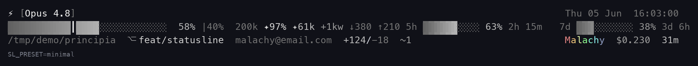</p>

| Preset | Vibe |
|--------|------|
| `minimal` | mono, no motion, plain bar |
| `pretty` | synthwave + wave shimmer, crest, moon, rainbow stats |
| `focus` | calm nord, breathing bar, burn rate + git |
| `chaos` | disco, plasma, pet, the works |
| `demo` | the kitchen-sink showcase |

…and ten personas — opinionated, complete looks:

| Persona | Vibe |
|--------|------|
| `stillness` | mono, breathing, nothing else |
| `operator` | mono + scan, burn rate + cost flair + git |
| `observatory` | tokyonight + comet, moon, day/night, crest |
| `cabin` | gruvbox + breathe, pet, moon, day/night |
| `hacker` | matrix theme & bar + scan, crest, git, burn |
| `warroom` | heat + sweep, burn + git + cost flair + crest |
| `lofi` | rosé pine + wave, pet, moon, day/night |
| `outrun` | synthwave + wave, rainbow stats |
| `wraith` | mono + snake bar + comet, moon, cost flair — alive but barely there |
| `arcade` | dracula + pac-man bar, pet, cost flair, rainbow stats |

<p align="center">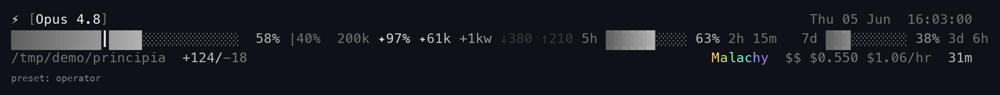</p>

### Themes

`"theme": "gruvbox"`. There are ~80. A theme recolours the whole line.

<p align="center">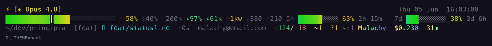</p>

Hue-ramp & designer: `heat` · `synthwave` · `matrix` · `pastel` · `mono` · `dracula` · `nord` ·
`gruvbox` · `tokyonight` · `rosepine` · `catppuccin-{latte,frappe,macchiato,mocha}` ·
`solarized-{dark,light}` · `kanagawa` · `everforest` · `onedark` · `ayu-{dark,mirage,light}` ·
`github-{dark,light}` · `monokai{,-pro}` · `cyberpunk` · `phosphor{,-green,-white}` · `verdigris` ·
`sumi-e` · `stealth` · `zen` · `void` · `gothic` · `oceanic` · `amber-crt` · `noir` · `vaporwave` ·
`blueprint` · `ember` · `paperwhite` · `neon-tokyo` · `sepia` · `arctic` · `terminal-green` · `dusk` ·
`oxocarbon` · identity flags (`pride` · `trans` · `bi` · `ace` · `nonbinary`).

Most of these aren't just a palette — they use the styling engine to set a *voice*: `matrix` and
`phosphor` go ALL-CAPS, `gothic` is small-caps with `LOW`→`DOOM`, `synthwave`/`void` script the name,
`stealth` dims everything, `sumi-e` lowercases. See **Style any element yourself** below.

**Scientific colour maps** (perceptually-uniform, several colour-blind-safe):

<p align="center">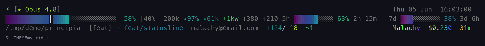</p>

`viridis` · `inferno` · `magma` · `plasma` · `cividis` · `twilight{,_shifted}` · `cubehelix` ·
`batlow` · `turbo` · `coolwarm` · `rdbu` · `ice` · `deep`.

**Reactive themes** — `"autoTheme": "daynight"` (with `dayTheme`/`nightTheme`), `"seasonal"`, or
`"branch"` (theme follows your git branch via `branchThemes`). `silver-halide` adds a darkroom
safelight wash when context gets critical.

<p align="center">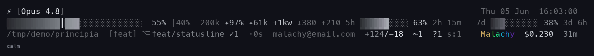</p>

**Roll your own** — `"theme": "custom"` with an inline `customTheme` (a cmap or palette), or point
`themeFile` at a JSON theme, or hand it a `base16` palette string. Themes can also restyle individual
elements (here `cyberpunk` gives the clock an accent and bolds the cost):

<p align="center">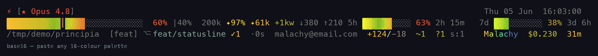</p>

### Bars, scale & motion

`"barStyle": "braille"` — `blocks` · `pacman` · `snake` · `matrix` · `braille` · `battery` · `thermo`
· `shade` · `lines` · `rule` · `equalizer` · `dna` · `train` · `waveform` (frozen oscilloscope) ·
`retro` (`#`/`-`, mono-friendly) · `arrows` (`→`/`·` pipeline).

<p align="center">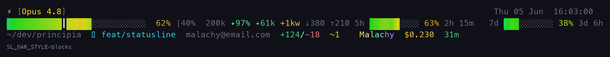</p>

`"barScale": "log"` expands the danger zone so you notice the cliff earlier.

<p align="center">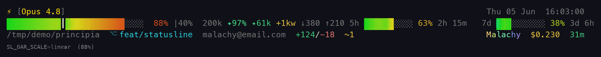</p>

`"shimmer": "wave"` animates the bar crest — `sweep` · `wave` · `comet` · `breathe` · `scan`, plus the
fancy ones: `drift` · `plasma` · `lumin` · `heartbeat` · `twinkle` · `storm` · `glitch` · `morse` ·
`flash` (on % change) · `ripple` (on update) · `tide` (layered waves) · `smoulder` (fading embers) ·
`lightning` (rare streak). And `disco`, which is a joke mode. Use responsibly.

<p align="center"></p>
<p align="center">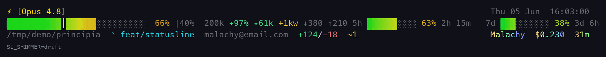</p>
<p align="center">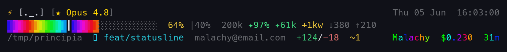</p>

### The extras

Flip any of these on (all default off):

| Key | Does |
|-----|------|
| `pet` | a width-1 ASCII pet whose mood tracks context/cost/git (`petStyle`, `petReactsTo`) |
| `crest` | a tier badge (★/▲/◆) before the model |
| `moon` | current moon phase |
| `daynight` | tints the clock by time of day |
| `gitExtra` | branch state, ahead/behind, commits-today, stash, untracked, last-commit age |
| `gitRisk` | a rough composite "risk" tag |
| `burn` | $/hr burn rate + how it compares to your own median |
| `costFlair` | a `$`/`$$`/`!$` marker by spend |
| `trend` | a sparkline of recent context % + an ETA to autocompact |
| `weather` | a one-word read of context pressure |
| `limits` | flag the usage gauges amber/red near the cap (`limitWarn`, `limitCrit`) |
| `rainbowStats` | rainbow the cost / age numbers |
| `sysinfo` | 1-minute load average |
| `bell` | ring the terminal bell once when context crosses a band |
| `nerdfont` | use Nerd Font glyphs |
| `warningLine` | a conditional ⚠ line that appears only when context/cost/limit crosses a threshold |
| `activityLine` | the last tool + target from the transcript (`↳ edit bar.ts`) |
| `conversationLine` | the last turn's token split + session total |
| `adaptive` | layout follows context fill — compact when low, dashboard when high, auto-⚠ at critical |
| `runs` | progress bars for long-running jobs, above the status line — see [Run progress](#run-progress) |

Each opt-in extra, shown on its own:

<p align="center">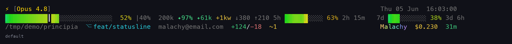</p>

`gitExtra` / `gitRisk` surface your repo at a glance — clean, uncommitted edits, staged, untracked,
stash, ahead/behind upstream, detached HEAD, and a rough risk tag:

<p align="center">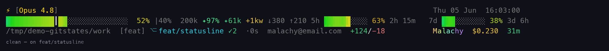</p>

<p align="center">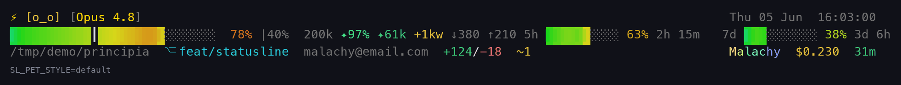</p>
<p align="center">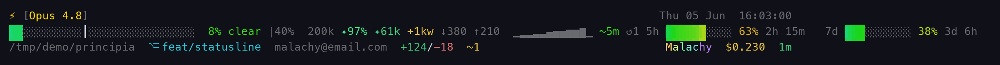</p>

Layout & housekeeping: `"layout"` (`3line` · `2line` · `1line` · `tiny` · `inverse` · `merged` ·
`bicolumn` · `barfirst` · `header` · `split` dashboard · `brackets` sections), `responsive` (pick layout by width),
`frame` (`rule` between lines, or a `box` border), `hide` (drop named segments), `separator`,
`path` (`auto` truncates deep paths), `privacy`
(hide email/account/cost/path for screenshots), `projectAliases`, `customSegment` (run your own
script), `tmuxPassthrough`.

<p align="center">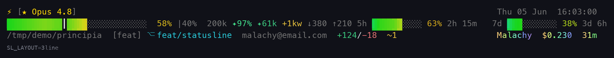</p>

…plus richer shapes — `inverse`, `merged`, `bicolumn`, `barfirst`, `header`, and the four-line `split`
dashboard:

<p align="center">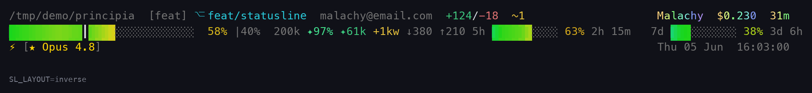</p>

`frame` wraps the whole thing in a `rule` between lines or a `box` border; `warningLine` adds a ⚠ line
only when context/cost/a limit goes critical (and `adaptive` does it for you):

<p align="center"></p>
<p align="center">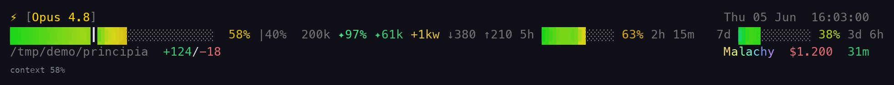</p>

### Run progress

Got a training run, an eval sweep, or a big download going? Have it drop a small JSON file in
`~/.claude/runs/` and the status line grows a bar for it — above the usual three lines, one per run,
and gone again when nothing's running.

<p align="center">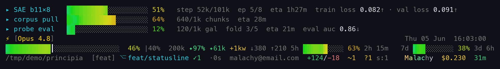</p>

```
▸ SAE b11×8      ▌▌▌▌▌▌▌▌▌▌▌▌▌▌▌▌▌░░░ 85%   step 86.8k/101k  ep 7/8  eta 25m  train loss 0.0734↓ · val loss 0.0858↓
✓ corpus pull    ▌▌▌▌▌▌▌▌▌▌▌▌▌▌▌▌▌▌▌▌ 100%  1k/1k chunks  done 3s ago
▸ probe eval     ▌▌▌▌▌▌▌▌▌▌▌▌▌▌░░░░░░ 74%   744/1k gal  fold 3/5  eta 6m  eval auc 0.902↑
⚡ [Opus 4.8]                                                                      Thu 05 Jun  16:03:00
▌▌▌▌▌▌▌▌▌▌▌▌▌┃░░░░░░░░░░░░░░  46% |40%  200k  ✦97%   5h ▌▌▌▌▌▌░░░░ 63%   7d ▌▌▌░░░░░░░ 38%
/tmp/demo/principia  ⎇ feat/statusline  +124/-18  ~1                        Malachy  $0.230  31m
```

Turn it on with `"runs": true`, or tune it:

```json
{
  "runs": {
    "dir": "~/.claude/runs",
    "max": 4,
    "staleAfter": 900,
    "linger": 600,
    "metrics": true,
    "maxMetrics": 4,
    "logs": []
  }
}
```

| Key | Default | Does |
|-----|---------|------|
| `dir` | `~/.claude/runs` | where progress files live (`$SL_RUNS_DIR` overrides it) |
| `max` | `4` | most bars shown; the rest collapse into a `+N more runs` line (live runs win the slots) |
| `staleAfter` | `900` | seconds without an update before a running job shows as `stale` (dimmed) |
| `linger` | `600` | seconds a finished / failed / stale run stays visible before it's hidden |
| `metrics` | `true` | show the `metrics` groups after the bar |
| `maxMetrics` | `4` | most metric values shown per run |
| `logs` | `[]` | log-tail specs for jobs that don't write progress files (below) |

Each run gets a status glyph: `▸` running, `◦` paused, `✓` done, `✗` failed — or `stopped?` when it
said it was running but its `pid` has gone away — and `◌ stale 12m` when it's gone quiet. Lines are
width-aware: when space runs short the least useful pieces go first (other metric groups, then
`eval`, `val`, the stage, the ETA, `train`), the message is truncated, and only then do the name and
bar shrink. Nothing ever wraps.

<p align="center">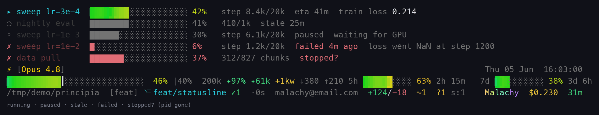</p>

#### The run progress API (format v1)

One JSON file per run, any name ending in `.json`. Write it **atomically** (to a temp file, then
rename) so the status line never reads half a file. Everything is optional except `name` and some
measure of progress; unknown fields are ignored, so the format can grow without breaking anything.

```json
{ "v": 1, "name": "A1 SAE b11×8", "status": "running",
  "step": 41200, "steps": 101308, "epoch": 6, "epochs": 8,
  "metrics": { "train": { "loss": 0.0353, "nmse": 0.035 }, "val": { "loss": 0.041 }, "eval": { "auc": 0.912 } },
  "stage": { "current": 12, "total": 56, "label": "chain step" },
  "message": "warming up", "started": 1791630000000, "updated": 1791630196688, "pid": 12345 }
```

| Field | Type | Meaning |
|-------|------|---------|
| `v` | number | format version (currently `1`) |
| `name` | string | **required** — the label on the bar |
| `status` | string | `running` (default) · `paused` · `done` · `failed` |
| `current`, `total`, `unit` | number, number, string | a generic counter: `230/1k gal` |
| `step`, `steps` | number | step counter: `step 41.2k/101k` |
| `epoch`, `epochs` | number | epoch counter: `ep 6/8` |
| `percent` | number | explicit 0–100; wins over every derived fraction |
| `metrics` | object | `{ group: { name: number } }` — `train`, `val`, `eval` are shown in that order, other groups after |
| `stage` | object | an outer progress `{ current, total, label }`: `chain step 12/56` |
| `message` | string | short free text, shown last (truncated to fit) |
| `started` | epoch ms | when it began — gives the ETA |
| `updated` | epoch ms | last progress; defaults to the file's mtime |
| `pid` | number | the job's process; if it's gone while `running`, the bar says `stopped?` |

The bar's fill comes from `percent`, else `current/total`, else `step/steps`, else `epoch/epochs`;
with none of those it shows just the count (and, if a shimmer is on, a band sweeping the track).
The ETA comes from `started`; without it the status line remembers when it first saw the run and
estimates from there. Metrics get a `↓`/`↑` against the last different value seen.

**Python** — a dependency-free helper; drop it in your training script:

```python
import json, os, re, tempfile, time

RUNS = os.path.expanduser(os.environ.get("SL_RUNS_DIR", "~/.claude/runs"))

def report(name, **fields):
    """Merge `fields` into this run's progress file (atomically: write a temp file, rename)."""
    os.makedirs(RUNS, exist_ok=True)
    path = os.path.join(RUNS, (re.sub(r"[^a-z0-9]+", "-", name.lower()).strip("-")[:64] or "run") + ".json")
    try:
        with open(path) as f: run = json.load(f)
    except (OSError, ValueError):
        run = {}
    now = int(time.time() * 1000)
    metrics = run.get("metrics", {})
    for group, kv in fields.pop("metrics", {}).items():
        metrics[group] = {**metrics.get(group, {}), **kv}
    run.update(fields, v=1, name=name, metrics=metrics, updated=now, pid=os.getpid())
    run.setdefault("started", now)
    fd, tmp = tempfile.mkstemp(dir=RUNS, prefix=".", suffix=".tmp")
    with os.fdopen(fd, "w") as f: json.dump(run, f)
    os.replace(tmp, path)

report("A1 SAE b11×8", step=step, steps=total_steps, epoch=epoch, epochs=8,
       metrics={"train": {"loss": loss}})
report("A1 SAE b11×8", metrics={"val": {"loss": val_loss}})   # merges; train is kept
report("A1 SAE b11×8", status="done")
```

It records `pid=os.getpid()`, so a run that crashes without saying `done` shows as `stopped?`
rather than sitting at "running" forever. Reporting progress on a run that had finished starts it
afresh.

**Bash** — no helper needed:

```bash
dir=${SL_RUNS_DIR:-$HOME/.claude/runs}; mkdir -p "$dir"
printf '{"name":"backup","current":%d,"total":%d,"unit":"GB"}' "$done_gb" 120 > "$dir/.backup.tmp" \
  && mv "$dir/.backup.tmp" "$dir/backup.json"
```

**The CLI** — `statusline.js` can write the file for you (merging like the Python helper):

```bash
node ~/.claude/statusline.js --run "A1 SAE b11×8" --step 41200 --steps 101308 --epoch 6 --epochs 8 \
  --metric train.loss=0.0353 --metric val.loss=0.041
node ~/.claude/statusline.js --run "probe eval" 230 1000 --unit gal --stage 3/5:fold --message scoring
node ~/.claude/statusline.js --run "probe eval" --status done
node ~/.claude/statusline.js --run-clear "probe eval"
```

Flags: `--step` `--steps` `--epoch` `--epochs` `--percent` `--metric group.name=value` (repeatable)
`--stage N/M[:label]` `--unit` `--status` `--message` `--pid`; two bare numbers are `current total`.

**Log tails** — for a job that only writes a log, point a regex at it. The status line reads the last
64 KiB on each repaint; each named group takes its value from the last line that matched it, so
progress and metrics can come from different lines:

```json
{
  "runs": {
    "logs": [{
      "name": "nightly train",
      "log": "~/runs/nightly/train.log",
      "pattern": "step (?<step>\\d+)/(?<steps>\\d+)|loss=(?<metric_train_loss>[0-9.e-]+)|val_loss=(?<metric_val_loss>[0-9.e-]+)",
      "done": "Training complete",
      "failed": "Traceback|CUDA out of memory"
    }]
  }
}
```

Groups: `cur` (with `total`, or a fixed `"total"` in the spec), `step`, `steps`, `epoch`, `epochs`,
`percent`, and `metric_<group>_<name>`. `done` / `failed` mark the status — whichever appears last
wins — and `updated` is the log's mtime.

**Limits, by design** — the status line repaints every second, so it stays cheap: it reads at most
the 32 newest progress files (each under 16 KiB), up to 8 log specs at 64 KiB each, and keeps a small
bounded cache in the temp dir for the ETA and arrows. A malformed or half-written file is just skipped.
`stopped?` relies on `pid` being on this machine, so leave it out for jobs that write to a shared disk
from elsewhere.

### Style any element yourself

This is the fun part. Every element — `git.branch`, `cost.amount`, `clock`, `name`, `model.tier`,
`bar.empty`, `usage.pct`, … (~55 of them) — flows through one styling engine, so you can override any
of them in `elements`:

<p align="center">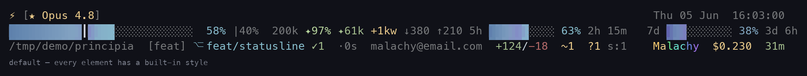</p>

```json
{
  "theme": "tokyonight",
  "elements": {
    "name":        { "fill": "gradient", "anim": { "kind": "wave" } },
    "cost.amount": { "fill": "warn", "weight": "bold" },
    "clock":       { "fill": "muted", "case": "upper" },
    "git.branch":  { "font": "smallcaps" }
  }
}
```

Per element you can set:

- **`fill`** — a semantic role (`fg` · `muted` · `accent` · `ok` · `warn` · `bad` · `info` · `gold`),
  a `#rrggbb`, `gradient` (follows the theme), or `rainbow`. So yes — rainbow name/cost/age are just
  `"fill": "rainbow"`, and you can swap them to a theme-matched `gradient` instead.
- **`weight`** — `normal` · `bold` · `dim`
- **`case`** — `upper` · `lower` · `title`
- **`attrs`** — `italic`, `underline`
- **`anim`** — `wave` · `rainbow` · `gradient-cycle` · `pulse` · `breathe` (with a `speed`)
- **`font`** — opt-in Unicode pseudo-fonts: `bold` · `italic` · `script` · `smallcaps`
  > ⚠️ Pseudo-fonts look great but break exact alignment, copy-paste, and screen readers. Off by
  > default, and never applied to the bar.
- **`glyph`** / **`label`** — change an element's icon or wording.

Themes can ship their own `elements`/`glyphs`/`labels` too, so a theme can genuinely *say different
things*. The cascade is: built-in default → theme → your config → live state.

### Colour depth & accessibility

Auto-detected, override with `SL_COLOR_MODE` (env) or `"colorMode"`: `truecolor` · `256` · `16` ·
`mono`. [`NO_COLOR`](https://no-color.org/) forces mono.

<p align="center">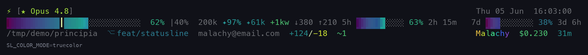</p>

`"accessible": true` is a proper high-contrast mode built to the guidelines (on a dark terminal):
white text, accents lightened to clear **WCAG AAA (7:1)**, motion and pseudo-fonts off, no rainbow —
and it wins over any theme, reaching every element. Pick the gauge with `accessibleGauge`:

| `accessibleGauge` | ramp | notes |
|---|---|---|
| `cvd` *(default)* | blue → cyan → yellow | colour-blind-safe (survives protan/deutan/tritan) |
| `traffic` | green → amber → red | familiar; relies on bar length for CVD users |
| `grayscale` | dim → bright | pure luminance; works on mono displays too |

<p align="center">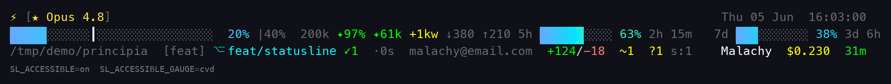</p>

### Coming from the old `SL_*` env vars?

Config used to be ~50 environment variables; it's now the one JSON file. Run this once and save the
output:

```bash
node ~/.claude/statusline.js --migrate > ~/.claude/statusline.json
```

It reads whatever `SL_*` you still have set and prints the equivalent JSON. (`--doctor` will also warn
you if any legacy `SL_*` vars are still hanging around.)

---

## Tooling

```bash
node statusline.js --preview    # render every theme / bar / shimmer
node statusline.js --doctor     # terminal capabilities, active config, conflicts
node statusline.js --report     # summarise your cross-session usage history
node statusline.js --migrate    # legacy SL_* env → JSON config (stdout)
node statusline.js --run <name> [current total] [--step N --metric train.loss=V …]   # report run progress
node statusline.js --run-clear <name>                                                # remove a run
```

---

## Development

TypeScript in `src/`, organised by concern: `build.ts` orchestrates a render; `segments/` builds each
piece (model, git, cost, clock, …), `io/` handles stdin / git-cache / state, `render/` does layout and
the whole-line washes, `anim/` holds the shimmer strategies, over leaf utilities (`style`, `themes`,
`bar`, `ansi`, `color`, `config`, …). esbuild bundles it all into a single zero-dependency CommonJS
`statusline.js` — so the runtime is just `node statusline.js`.

```bash
npm run build        # bundle src → statusline.js
npm run typecheck    # tsc --noEmit
npm run lint         # eslint
npm run test:unit    # fast unit tests, straight from src/ via tsx (no bundle)
npm test             # unit, then build + golden/behaviour tests
npm run goldens      # rebuild and refresh golden snapshots after an intentional change
npm run preview      # build and render the gallery
npm run render       # regenerate the demo GIFs (needs Python + Pillow)
```

Two test layers: pure functions have direct unit tests in `test/unit/` (run via tsx), and the built
artifact is compared to committed golden snapshots in `test/golden/` across colour modes, themes,
layouts, and the styling engine. CI runs typecheck + lint + both suites on Node 18 & 20, and checks the
committed bundle matches a fresh build.

<details>
<summary>How the bar is drawn</summary>
The context bar uses half-blocks (<code>▌</code>) sampled twice per character for a smooth truecolor
gradient, with a moving hue crest. Below truecolor it degrades to solid blocks (256/16) or bold/dim
<code>█</code>/<code>░</code> (mono). Every default glyph is width-1, so the three lines always align.
</details>

---

MIT · made by [@Ma1achy](https://github.com/Ma1achy) with an unreasonable amount of care for a status line.
